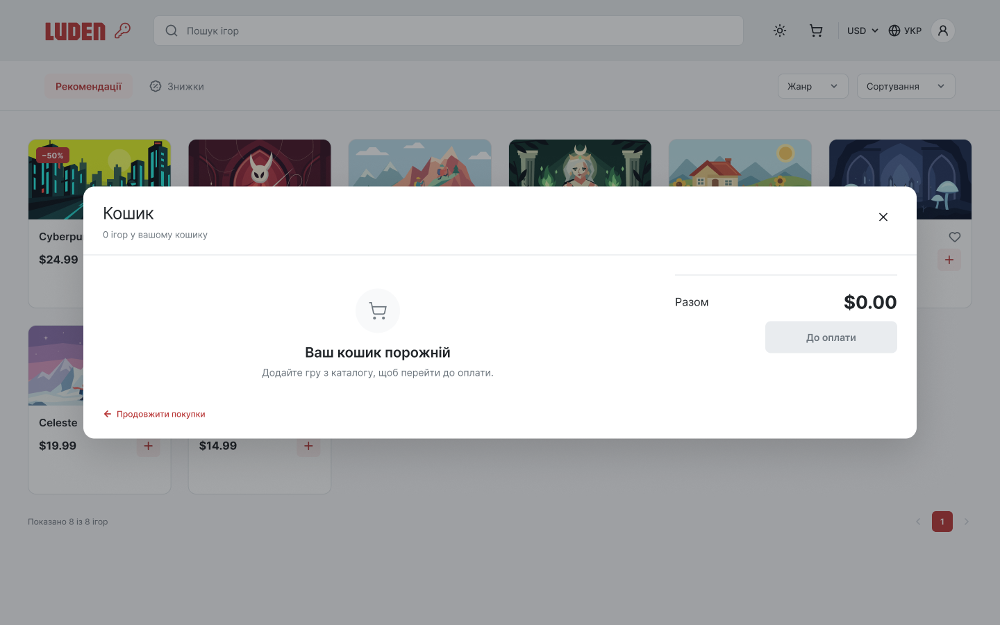

# Контракти екранів Luden

Контракти описують видимі поля, переходи й обмеження 15 кадрів. [Карта](02_Screen_Map.md) перелічує всі кліки. Вимоги до застосунку наведено в [Input Pack](../01_requirements/01_Input_Pack_v0.1.md).

## Поверхні та контроли

| Кадр | Дані й контроли | Стан у Figma |
| --- | --- | --- |
| S-01 | Email, пароль, C-01 «Увійти», C-02 «Зареєструватися», C-17 іконка видимості | C-01 → S-03-A, C-02 → S-01-R. C-17, Google і відновлення пароля без переходів |
| S-01-R | Email, пароль, підтвердження, підказка про 8 символів, C-03 «Зареєструватися», C-18 «Повернутися до входу» | C-03 → S-03-A, C-18 → S-01. Валідацію та створення облікового запису перевіряють у застосунку |
| S-02-A/P | Вісім карток, C-04 пошук, C-05 картка Cyberpunk 2077, C-06 іконка кошика, C-16 жанр, C-19 «Моя бібліотека» | C-04 → S-02-R/RP, C-05 → M-01, C-19 → S-03-A/B відповідно. C-06 і C-16 без переходу |
| S-02-R/RP | Один результат, C-04 поле, C-07 «Очистити пошук», C-05 картка, C-19 бібліотека | C-04 → спільний S-02-B. C-07 і C-19 зберігають варіант до або після покупки. C-05 → спільний M-01 |
| S-02-B/C | Запит zz-no-match і C-07 або повідомлення про помилку і C-20 «Спробувати ще раз» | C-07 та C-20 ведуть у S-02-A |
| M-01 | Cyberpunk 2077, жанрові мітки, опис, платформа, $24.99, C-08 «До кошика», C-09 хрестик | C-08 → M-02. C-09 → S-02-A з усіх входів |
| M-02/E | Кількість C-10, C-11 видалення, C-12 «До оплати», C-21 хрестик | M-02 має 1 гру і $24.99, C-11 → M-02-E, C-12 → M-03. У M-02-E підсумок $0.00, C-12 не має переходу. C-21 веде в каталог. «Продовжити покупки» без реакції |
| M-03/E | $24.99 USD, кількість 1, демонстраційна картка, бонуси 0, C-14 «Скасувати», C-22 хрестик | C-14 → M-02. C-13 «Підтвердити» у M-03 → S-03-B. C-23 «Спробувати ще раз» у M-03-E → M-03. C-22 без реакції |
| S-03-A/B | Профіль «Гравець Luden», «Моя бібліотека», C-15 перехід у магазин | A — 0 ігор і дві дії переходу до S-02-A. B — Cyberpunk 2077 і «Магазин» → S-02-P. «Замовлення» й «Обране» без реакцій |

M-01, M-02/E і M-03/E — повноекранні кадри із затемненим фоном каталогу. [Критерії клавіатури та фокуса](../05_qa/Test_Cases.md#перевірки-застосунку)

## Права

| Дія | Відвідувач | Покупець | Admin |
| --- | --- | --- | --- |
| Читати каталог і деталі | Дозволено вимогами. Гостьовий старт у Figma відсутній | Дозволено | Дозволено |
| Відкрити профіль і бібліотеку | Потрібен вхід | Власні дані | Власні дані |
| Оформити оплату | Потрібен вхід | Дозволено | Залежить від рішення Q-08 |
| Створити, змінити або видалити товар | Відмова через відсутність сесії | Відмова за роллю | Дозволено |

Покупецький потік Figma не містить дій керування товарами. Автентифікація й авторизація потребують серверної перевірки за BR-02.

## Стани замовлення у зрізі

| Умова в застосунку | Правило доступу |
| --- | --- |
| Власне замовлення Paid або Completed | Ігри з цього замовлення доступні в бібліотеці |
| Неоплачене або чуже замовлення | Новий доступ не видається |
| Відмова оплати | Покупець бачить повідомлення на оформленні. Новий доступ не видається, раніше придбані ігри зберігаються |

Figma показує S-03-A, S-03-B і M-03-E як окремі кадри. Статуси, власність і видачу ліцензій перевіряють у застосунку. Допустимі переходи статусів потребують рішення Q-07.

## Очікувані переходи

Ревізія на погодженні. T-01…T-33 посилаються на зв’язки [поточного макета](02_Screen_Map.md#кадри-й-переходи). Для кожної зміненої дії нижче вказано стан входу, умову й результат. Нові переходи мають ID починаючи з T-34. Події сервісу показують підготовленими варіантами кадрів.

| ID | Вхід і дія | Умова й результат | Підстава · тест |
| --- | --- | --- | --- |
| T-01, T-03 | S-01 «Увійти», S-01-R «Зареєструватися» | Підготовлені валідні дані. Успіх відкриває власну бібліотеку або виконує дію, перервану входом | SRC-01, P-03/P-04 · F-T01/F-T07 |
| T-34 | S-01, S-01-R · подати невалідну форму | Залишити дані на формі, показати помилку біля поля або форми. Різні паролі, короткий пароль і невалідний email блокують подання. Зайнятий email або неправильні облікові дані моделюються окремим результатом | AC-01.3/01.4/02.3, P-03 · F-T07 |
| T-35 | S-01 · іконка видимості пароля | За наявності демонстраційного пароля перемикає його подання. Значення й повідомлення форми зберігаються | AC-02.4 · F-T05/F-T07 |
| T-15, T-36 | Вхід до каталогу або повтор із S-02-C | Показати стан завантаження з індикатором, потім відповідний список або окрему помилку. Повтор не запускається ще раз під час завантаження | AC-03.2–4 · F-T06/F-T07 |
| T-37 | Каталог / пошук · вибір жанру | Показати вибраний жанр і перерахувати список за жанром та поточним запитом. Нуль збігів відкриває варіант порожнього пошуку | AC-04.1/04.2/04.4 · F-T02/F-T07 |
| T-11, T-14, T-31 | Результат або стан без збігів · очистити запит | Очистити лише текст. Зберегти жанр, стан придбання та значок кошика. У післяпокупковому сценарії бібліотека веде до S-03-B | AC-04.3, P-07 · F-T02/F-T04 |
| T-08, T-13, T-29, T-33, T-16 | Картка · відкрити деталі, M-01 · × | Відкрити ту саму гру. Закриття відновлює каталог або результати, з яких відкрито деталі. Для придбаної гри показати «У бібліотеці» | AC-05.1–3, P-01/P-07 · F-T04 |
| T-17, T-38 | Непридбана гра · «До кошика» в деталях або + на картці | Додати одну позицію, відкрити M-02 із сумою $24.99 у сценарії Cyberpunk 2077. Повторне додавання зберігає одну позицію. Для гостя діє T-45 | AC-05.4/06.1, P-01/P-04 · F-T01/F-T07 |
| T-39 | Каталог чи результати · іконка кошика | Для покупця показати M-02 або M-02-E за складом кошика. Індикатор у каталозі дорівнює кількості позицій. Для гостя діє T-45 | SRC-03, P-04/P-07 · F-T03 |
| T-18, T-21, T-40 | M-02 або M-02-E · × або «Продовжити покупки» | Повернути попередній каталог. Непорожній кошик зберігає позицію й значок до T-39. Після T-19 показати порожній кошик і $0.00 | AC-06.2–4, P-07 · F-T03/F-T05 |
| T-20, T-22, T-24, T-41 | Кошик · «До оплати», M-03/E · «Скасувати» або × | Вхід до оплати лише з непорожнього кошика. Скасування або закриття до підтвердження чи після відмови повертає до кошика з тією самою сумою та складом | AC-07.1/07.5, P-07 · F-T03/F-T06 |
| T-23, T-25, T-42, T-43 | M-03 «Підтвердити», M-03-E «Спробувати ще раз» | Початкова й повторна спроби відкривають стан «Обробляємо оплату» з недоступним повторним підтвердженням. Успіх відкриває S-03-B і очищує оплачену позицію, відмова відкриває M-03-E зі збереженим кошиком та старими ліцензіями | AC-07.3/07.4/08.2, P-02 · F-T06/F-T07 |
| T-44 | Деталі придбаної гри · «Відкрити бібліотеку» | Показати власну бібліотеку з цією грою. У каталозі + для цієї гри приховано | SRC-05, P-01 · F-T04/F-T07 |
| T-45, T-46, T-47 | Гостьовий каталог або деталі · захищена дія | Запам’ятати вихідний стан і дію, відкрити S-01. Після успіху виконати захищену дію один раз. «До магазину» повертає до вихідного стану без виконання дії | BR-01, P-04 · F-T07 |

Для переходу повторної оплати T-25 має вести до обробки, T-42 завершує її успіхом, T-43 — відмовою. Для гостьового маршруту T-45 відкриває вхід, T-46 продовжує дію, T-47 скасовує. Окремі стартові потоки дають відтворювані результати відмови та помилок форми без службових кнопок у кадрі продукту.

## Traceability

| Критерії | Кадри й контроли | Перевірка |
| --- | --- | --- |
| AC-01.1–4 | S-01-R, C-02/C-03/C-18 | F-T01, APP-01 |
| AC-02.1–4 | S-01, C-01/C-17 | F-T01, F-T05, APP-01 |
| AC-03.1–4 | S-02-A/C, C-20. Стану завантаження немає | F-T06, APP-02 |
| AC-04.1–4 | S-02-A/R/B/P/RP, C-04/C-07/C-16 | F-T02, F-T04, APP-02 |
| AC-05.1–4 | M-01, C-05/C-08/C-09 | F-T01, F-T04, APP-02 |
| AC-06.1–4 | M-02/E, C-10/C-11/C-12 | F-T01, F-T03, APP-03 |
| AC-07.1–5 | M-03/E, C-12/C-13/C-14/C-23 | F-T01, F-T03, F-T06, APP-03 |
| AC-08.1–4 | S-03-A/B, C-15/C-19 | F-T01, F-T04, APP-04 |
| BR-01–02 | Матриця прав, каталог і профіль | APP-02, APP-05 |
| D-05, NFR-01 | Кошик і видимі контроли | F-T03, F-T05 |

Покриття кожного з 33 AC і відповідні тести наведено в [Plan Review](../03_figma_prep/04_Plan_Review.md). Фактичні результати, прогалини й сценарії повторної перевірки наведено в [QA](../05_qa/Test_Cases.md).
