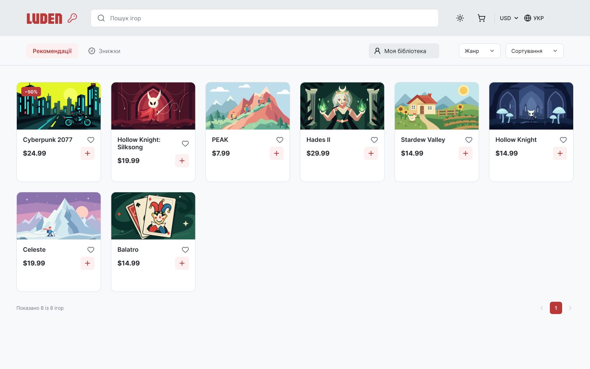
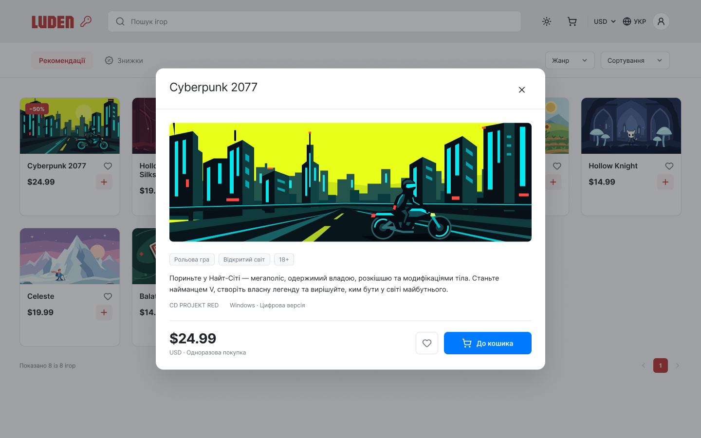

# Огляд макета Luden

**G6 · редакція timbuhtuk · 2026-11-07.** Актуальний дизайн — [Figma](https://www.figma.com/design/1CKu1SyAbPWcXXN46RHeV2/Luden?node-id=2-52052). Експортовано 15 кадрів, перевірено тексти, розміри й налаштовані переходи. Розділ 03 оновлено за цим зрізом.

## Актуальні кадри Figma

Усі PNG мають 1440 × 900. Джерело, node ID та SHA-256 наведено в [маніфесті](Figma_Export_Manifest.json); тексти й 33 переходи — в [інвентарі](Figma_Prototype_Inventory.json). Зображення збережено без зміни змісту.

| Кадр | Посилання |
| --- | --- |
| S-03-B Профіль — бібліотека після покупки | [PNG](screenshots/figma/S-03-B_library_purchase.png) · [Figma](https://www.figma.com/design/1CKu1SyAbPWcXXN46RHeV2/Luden?node-id=2-53349) |
| M-03-E Оплата — відмова | [PNG](screenshots/figma/M-03-E_payment_declined.png) · [Figma](https://www.figma.com/design/1CKu1SyAbPWcXXN46RHeV2/Luden?node-id=2-53156) |
| M-03 Оплата | [PNG](screenshots/figma/M-03_checkout.png) · [Figma](https://www.figma.com/design/1CKu1SyAbPWcXXN46RHeV2/Luden?node-id=2-52968) |
| M-02-E Кошик — порожній | [PNG](screenshots/figma/M-02-E_cart_empty.png) · [Figma](https://www.figma.com/design/1CKu1SyAbPWcXXN46RHeV2/Luden?node-id=2-52794) |
| M-02 Кошик | [PNG](screenshots/figma/M-02_cart.png) · [Figma](https://www.figma.com/design/1CKu1SyAbPWcXXN46RHeV2/Luden?node-id=2-52610) |
| M-01 Деталі Cyberpunk 2077 | [PNG](screenshots/figma/M-01_game_details.png) · [Figma](https://www.figma.com/design/1CKu1SyAbPWcXXN46RHeV2/Luden?node-id=2-52427) |
| S-02-C Помилка каталогу | [PNG](screenshots/figma/S-02-C_catalog_error.png) · [Figma](https://www.figma.com/design/1CKu1SyAbPWcXXN46RHeV2/Luden?node-id=2-52379) |
| S-02-B Немає збігів | [PNG](screenshots/figma/S-02-B_search_empty.png) · [Figma](https://www.figma.com/design/1CKu1SyAbPWcXXN46RHeV2/Luden?node-id=2-52328) |
| S-02-A Каталог | [PNG](screenshots/figma/S-02-A_catalog.png) · [Figma](https://www.figma.com/design/1CKu1SyAbPWcXXN46RHeV2/Luden?node-id=2-52179) |
| S-03-A Профіль — порожня бібліотека | [PNG](screenshots/figma/S-03-A_library_empty.png) · [Figma](https://www.figma.com/design/1CKu1SyAbPWcXXN46RHeV2/Luden?node-id=2-52139) |
| S-01-R Реєстрація | [PNG](screenshots/figma/S-01-R_register.png) · [Figma](https://www.figma.com/design/1CKu1SyAbPWcXXN46RHeV2/Luden?node-id=2-52096) |
| S-01 Вхід | [PNG](screenshots/figma/S-01_sign_in.png) · [Figma](https://www.figma.com/design/1CKu1SyAbPWcXXN46RHeV2/Luden?node-id=2-52052) |
| S-02-P Каталог після покупки | [PNG](screenshots/figma/S-02-P_catalog_purchased.png) · [Figma](https://www.figma.com/design/1CKu1SyAbPWcXXN46RHeV2/Luden?node-id=15-4019) |
| S-02-R Результат пошуку | [PNG](screenshots/figma/S-02-R_search_results.png) · [Figma](https://www.figma.com/design/1CKu1SyAbPWcXXN46RHeV2/Luden?node-id=15-4715) |
| S-02-RP Результат пошуку після покупки | [PNG](screenshots/figma/S-02-RP_search_purchased.png) · [Figma](https://www.figma.com/design/1CKu1SyAbPWcXXN46RHeV2/Luden?node-id=15-5411) |

### Каталог

### Деталі та кошик

### Оплата й результат

## Результат огляду Figma

Візуально переглянуто всі 15 експортів. Кольорові обкладинки, типографіка, назва Cyberpunk 2077, ціна $24.99, кількість 1 і підсумки узгоджені на основному маршруті. Порожні каталог і бібліотека, помилка каталогу та відмова оплати розділені. Окремі кадри підтримують повернення з бібліотеки до каталогу після покупки.

За налаштуваннями є 33 переходи ON_CLICK → NAVIGATE. Це не ручний прогін Present. M-кадри візуально модальні, проте не використовують OPEN_OVERLAY; поведінка фокуса, Escape й runtime disabled не перевірена.

[Plan Review](../03_figma_prep/04_Plan_Review.md) фіксує покриття всіх 33 AC. Виявлено втрату контексту покупки/пошуку, непідключені контроли, відсутні стани валідації, завантаження й processing, а також видимі Deferred-функції. Текст про мінімум 8 символів і позначка −50% потребують уточнення. Деталі — F-01…F-06 у [журналі](../05_qa/Defect_Change_Log.md#ревю-оновленої-figma).

## Попередній HTML-прототип

Матеріали нижче стосуються окремого [HTML-прототипу](Prototype.html) з Atlas Drift. Його дані, вигляд і поведінка не є копією нової Figma. Старі PNG залишено для простежуваності попередніх результатів; нові матеріали розташовані в `screenshots/figma/`.

Попередній звіт для версії 822a688 повідомляв про перевірку в Chrome через Playwright на viewport 1440 × 900. У репозиторії є 10 основних кадрів, чотири довідкові стани й один кадр кошика до правки. Протокол запуску та сирі DOM-вимірювання не додано. Під час поточної текстової редакції браузерні й серверні тести повторно не виконувалися.

### Кадри HTML

| Група | Докази |
| --- | --- |
| Автентифікація | [Вхід](screenshots/S-01_sign_in.png) · [Реєстрація](screenshots/S-01-R_register.png) · [Помилка входу](screenshots/REF-01_login_error.png) |
| Каталог | [Результати](screenshots/S-02-A_catalog.png) · [Немає збігів](screenshots/S-02-B_search_empty.png) · [Помилка запиту](screenshots/S-02-C_catalog_error.png) · [Завантаження](screenshots/REF-02_catalog_loading.png) |
| Вибір і оформлення | [Деталі гри](screenshots/M-01_game_details.png) · [Кошик](screenshots/M-02_cart.png) · [Порожній кошик](screenshots/REF-03_cart_empty.png) · [Оплата](screenshots/M-03_checkout.png) · [Відмова](screenshots/REF-04_payment_declined.png) |
| Бібліотека | [Порожня](screenshots/S-03-A_library_empty.png) · [З покупкою](screenshots/S-03-B_library_purchase.png) |

### Результати попереднього HTML-протоколу

REPORTED PASS означає попередню заяву про зазначену частину сценарію, а не новий прогін або приймання всього AC.

| Вимога | Зафіксована частина | Статус і межі |
| --- | --- | --- |
| AC-04.2–3 | Порожній результат, очищення з жанром | REPORTED PASS · повернення двох локальних ігор. Позитивний пошук і гостьова навігація окремо не підтверджені |
| AC-06.2–4 | Кількість, видалення, порожній кошик | REPORTED PASS · арифметика й disabled. Бізнес-модель копій відкрита в Q-06 |
| AC-07.1–2, 07.4–5 | Оформлення без бонусів, скасування й успішна симуляція | REPORTED PASS · локальні переходи та блокування повторної дії |
| AC-07.3 | Готовий стан відмови в M-03 | REPORTED PASS лише для показу повідомлення. Відсутність нової гри після відмови — T-08c NOT RUN |
| AC-08.1, 08.3–4 | Порожня/заповнена бібліотека, повернення | REPORTED PASS · локальні дані. AC-08.2 щодо власника й Paid/Completed не підтверджено |
| D-05 | Вирівнювання кошика | RECHECK REQUIRED · попередні 0 px і 12 px потребують повторного протоколу |
| BR-02 | Відсутність редагування у покупця | REPORTED PASS лише для UI; серверний контроль NOT RUN |

Для [кадру до](screenshots/M-02_before_review.png) попередньо заявлено зміщення 8,31 px, для [кадру після](screenshots/M-02_cart.png) — 0 px. Ці числа не відновлюються як точний DOM-вимір зі скріншота. CSS задає праве вирівнювання й gap 12 px; метод повторного вимірювання наведено в T-11.

### Зміни HTML-текстів після старого експорту

У поточному prototype.js уточнено два повідомлення: бібліотека пов’язує появу гри з успішною оплатою; відмова пропонує повтор або повернення до кошика. Експорти S-03-A_library_empty.png та REF-04_payment_declined.png зроблено раніше й можуть містити попередні формулювання. Потрібен повторний експорт цих двох станів; наявні кадри збережено як матеріали попереднього огляду.

### Межі попередніх доказів

У прототипі немає серверних користувачів, замовлень, ролей чи ліцензій. Провайдера платежів не визначено. Попередні заяви про зовнішній застосунок мають UNVERIFIED до встановлення репозиторію, версії й протоколу.

Детальні статуси — у [Test Cases](../05_qa/Test_Cases.md), відкриті питання — у [журналі](../05_qa/Defect_Change_Log.md). Контроль D та мінітест з учасником залишаються незавершеними.
