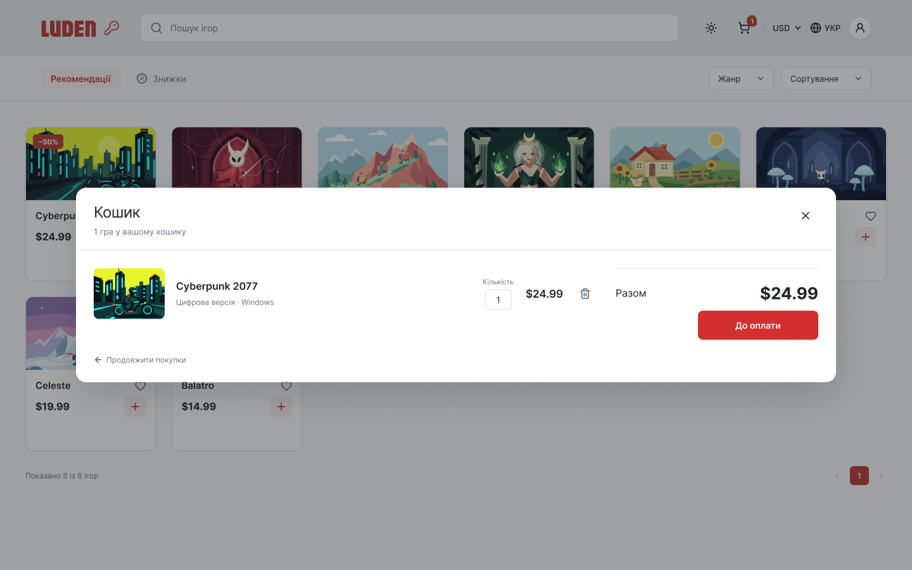
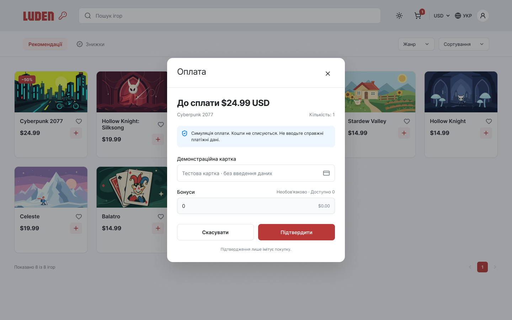
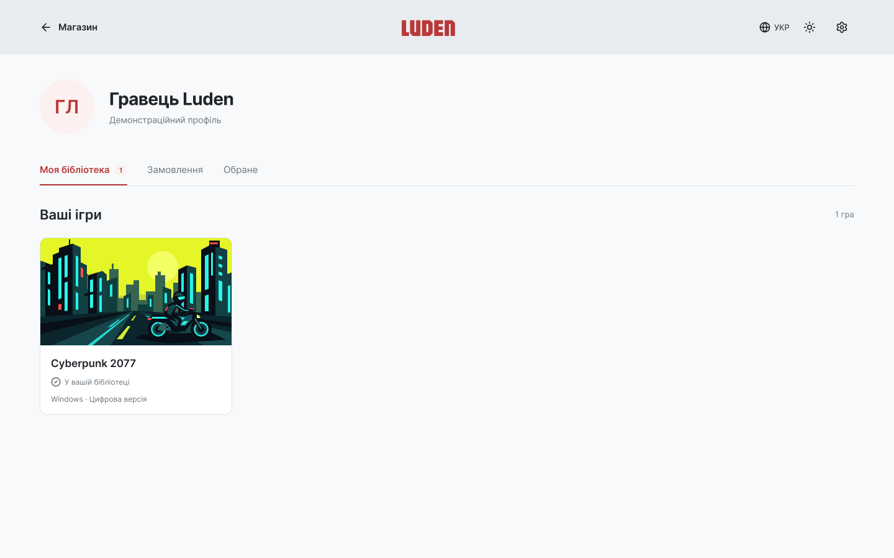

# Огляд макета Luden

Актуальний дизайн — [Figma](https://www.figma.com/design/1CKu1SyAbPWcXXN46RHeV2/Luden?node-id=2-52052). Повторно експортовано 15 кадрів і звірено тексти, розміри та налаштовані переходи.

## Актуальні кадри Figma

Усі PNG мають 1440 × 900. Таблиця поєднує кожен PNG із відповідним кадром у Figma. Усі 33 переходи описано в [карті екранів](../02_architecture/02_Screen_Map.md). Зображення збережено без зміни змісту.

| Кадр | Посилання |
| --- | --- |
| S-03-B Профіль — бібліотека після покупки | [PNG](screenshots/figma/S-03-B_library_purchase.png) · [Figma](https://www.figma.com/design/1CKu1SyAbPWcXXN46RHeV2/Luden?node-id=2-53349) |
| M-03-E Оплата — відмова | [PNG](screenshots/figma/M-03-E_payment_declined.png) · [Figma](https://www.figma.com/design/1CKu1SyAbPWcXXN46RHeV2/Luden?node-id=2-53156) |
| M-03 Оплата | [PNG](screenshots/figma/M-03_checkout.png) · [Figma](https://www.figma.com/design/1CKu1SyAbPWcXXN46RHeV2/Luden?node-id=2-52968) |
| M-02-E Кошик — порожній | [PNG](screenshots/figma/M-02-E_cart_empty.png) · [Figma](https://www.figma.com/design/1CKu1SyAbPWcXXN46RHeV2/Luden?node-id=2-52794) |
| M-02 Кошик | [PNG](screenshots/figma/M-02_cart.png) · [Figma](https://www.figma.com/design/1CKu1SyAbPWcXXN46RHeV2/Luden?node-id=2-52610) |
| M-01 Деталі Cyberpunk 2077 | [PNG](screenshots/figma/M-01_game_details.png) · [Figma](https://www.figma.com/design/1CKu1SyAbPWcXXN46RHeV2/Luden?node-id=2-52427) |
| S-02-C Помилка каталогу | [PNG](screenshots/figma/S-02-C_catalog_error.png) · [Figma](https://www.figma.com/design/1CKu1SyAbPWcXXN46RHeV2/Luden?node-id=2-52379) |
| S-02-B Немає збігів | [PNG](screenshots/figma/S-02-B_search_empty.png) · [Figma](https://www.figma.com/design/1CKu1SyAbPWcXXN46RHeV2/Luden?node-id=2-52328) |
| S-02-A Каталог | [PNG](screenshots/figma/S-02-A_catalog.png) · [Figma](https://www.figma.com/design/1CKu1SyAbPWcXXN46RHeV2/Luden?node-id=2-52179) |
| S-03-A Профіль — порожня бібліотека | [PNG](screenshots/figma/S-03-A_library_empty.png) · [Figma](https://www.figma.com/design/1CKu1SyAbPWcXXN46RHeV2/Luden?node-id=2-52139) |
| S-01-R Реєстрація | [PNG](screenshots/figma/S-01-R_register.png) · [Figma](https://www.figma.com/design/1CKu1SyAbPWcXXN46RHeV2/Luden?node-id=2-52096) |
| S-01 Вхід | [PNG](screenshots/figma/S-01_sign_in.png) · [Figma](https://www.figma.com/design/1CKu1SyAbPWcXXN46RHeV2/Luden?node-id=2-52052) |
| S-02-P Каталог після покупки | [PNG](screenshots/figma/S-02-P_catalog_purchased.png) · [Figma](https://www.figma.com/design/1CKu1SyAbPWcXXN46RHeV2/Luden?node-id=15-4019) |
| S-02-R Результат пошуку | [PNG](screenshots/figma/S-02-R_search_results.png) · [Figma](https://www.figma.com/design/1CKu1SyAbPWcXXN46RHeV2/Luden?node-id=15-4715) |
| S-02-RP Результат пошуку після покупки | [PNG](screenshots/figma/S-02-RP_search_purchased.png) · [Figma](https://www.figma.com/design/1CKu1SyAbPWcXXN46RHeV2/Luden?node-id=15-5411) |

### Каталог

### Деталі та кошик

### Оплата й результат

## Результат огляду Figma

Візуально переглянуто всі 15 експортів. Кольорові обкладинки, типографіка, назва Cyberpunk 2077, ціна $24.99, кількість 1 і підсумки узгоджені на основному маршруті. Пошук без збігів, порожня бібліотека, помилка каталогу та відмова оплати мають окремі кадри. Окремі кадри підтримують повернення з бібліотеки до каталогу після покупки.

Налаштовано 33 переходи ON_CLICK → NAVIGATE. Для діалогів використано повноекранні кадри із затемненням. Фокус, Escape й поведінка неактивної кнопки оплати потребують перевірки у Present.

[Plan Review](../03_figma_prep/04_Plan_Review.md) фіксує покриття всіх 33 AC. Виявлено втрату контексту покупки/пошуку, непідключені контроли, відсутні стани валідації, завантаження й обробки оплати, а також видимі Deferred-функції. Текст про мінімум 8 символів і позначка −50% потребують уточнення. Деталі — F-01…F-06 у [журналі](../05_qa/Defect_Change_Log.md#ревю-figma).
