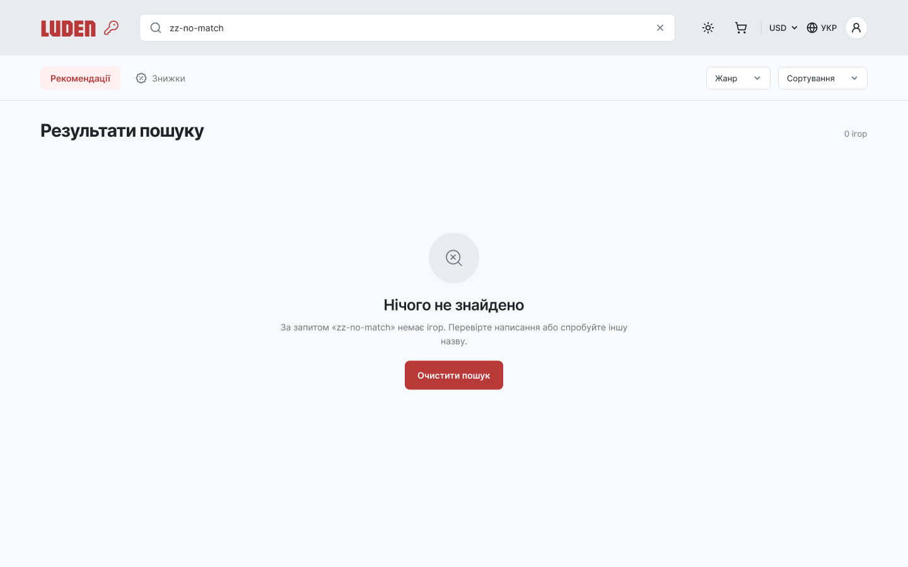
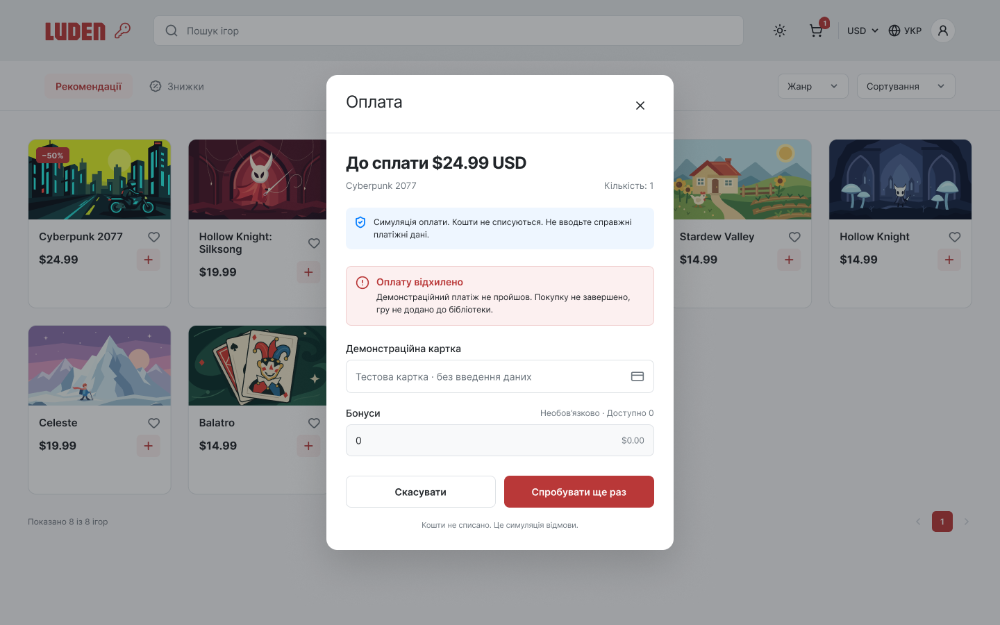

# Протокол перевірок Luden

Об’єкт огляду — 15 кадрів Figma та 33 налаштовані переходи зі зрізу `0e0b1dd`. Перевіряла Віка (Codex) **2026-11-20** у браузерному Present у режимі Fit width and height. Версію перевірки ідентифіковано ключем файлу `1CKu1SyAbPWcXXN46RHeV2`, стартовим вузлом `2:52052` та датою. Окрема іменована версія Figma для цього прогону відсутня. [Макет](https://www.figma.com/design/1CKu1SyAbPWcXXN46RHeV2/Luden?node-id=2-52052) · [Карта екранів](../02_architecture/02_Screen_Map.md)

## Перевірки Figma у Present

PASS або FAIL стосується виконаної дії за вказаних умов. PARTIAL означає, що виконано частину кроків. NOT RUN — результату прогону немає. Перед повтором відкрити зазначений потік і записати нову дату, версію та отриманий кадр.

| ID | Дії та очікуваний результат | Статус | Фактичний результат 2026-11-20 |
| --- | --- | --- | --- |
| F-T01 | «Покупка гри». Увійти, відкрити магазин, додати Cyberpunk 2077 і підтвердити симуляцію оплати. У бібліотеці має бути та сама гра | PASS | S-01 → S-03-A → S-02-A → M-01 → M-02 → M-03 → S-03-B. Кошик показав одну гру за $24.99, оплата — $24.99 USD, бібліотека — Cyberpunk 2077 |
| F-T02 | У S-02-A натиснути на пошук двічі. Перше натискання відкриває один результат, друге — нуль збігів. «Очистити пошук» повертає каталог | PASS | S-02-A → S-02-R (Cyberpunk 2077) → S-02-B (`zz-no-match`) → S-02-A (вісім карток). Перевірено готові стани |
| F-T03 | Скасувати оплату, видалити гру, перевірити порожній стан. Окремо закрити непорожній кошик і знову відкрити його з каталогу | FAIL | «Скасувати» в M-03 повернуло Cyberpunk 2077 і $24.99 у M-02. Видалення показало M-02-E, $0.00 і візуально неактивне «До оплати». У непорожньому M-02 × повернув S-02-A без індикатора. Клік на іконку кошика не відкрив його |
| F-T04 | Після покупки повернутися з S-03-B у магазин. Відкрити й закрити деталі, потім перейти до бібліотеки. Повторити з порожнім пошуком. Cyberpunk 2077 має лишитися в бібліотеці | FAIL | Відтворено S-03-B → S-02-P → M-01 → S-02-A → S-03-A (0 ігор). Гілку через порожній пошук після покупки зафіксовано за графом T-30 → T-14 → T-09, окремо в Present її не проходили |
| F-T05 | Перевірити «Продовжити покупки», іконку кошика, × оплати, перемикач пароля та жанр | FAIL | «Продовжити покупки» не перемикає M-02 або M-02-E. Іконка кошика не відкриває M-02 із S-02-A. × не закриває M-03 або M-03-E. Перемикач пароля й жанр лишаються прогалинами за вихідним графом |
| F-T06 | Відкрити потоки «Помилка каталогу» та «Відмова оплати». Повтор повертає каталог або дає повторити оплату. Окремо перевірити скасування з кадру відмови | PARTIAL | S-02-C → S-02-A після повтору. У M-03-E видно «Оплату відхилено», повтор веде в M-03. Скасування перевірено з M-03 після повтору, прямий T-24 наведено у карті |
| F-T07 | Після доопрацювання перевірити вхід/реєстрацію та повернення гостя, помилки форм, жанр із очищенням, завантаження, обробку оплати, пряму дію + і заборону повторної покупки за новим брифом | NOT RUN | Очікує погодженої та оновленої версії макета |

## Перевірки застосунку

| ID | Що перевірити | Статус |
| --- | --- | --- |
| APP-01 | Реєстрація, дублікат email, різні паролі, вхід, серверна сесія та помилка входу | NOT RUN |
| APP-02 | Гостьовий доступ, завантаження каталогу, повтор запиту, довільний пошук, фільтр жанру та деталі обраної гри | NOT RUN |
| APP-03 | Видалення й сума кошика, одна ліцензія та повторне додавання, оплата без бонусів, блокування під час обробки, скасування, повтор і відмова без зміни наявних прав | NOT RUN |
| APP-04 | Бібліотека містить лише ігри з власних Paid або Completed замовлень | NOT RUN |
| APP-05 | Покупець і неавтентифікований запит не можуть змінити товар. Запит із дозволеною роллю Admin перевірити окремо | NOT RUN |
| QA-01 | Виміряти контраст тексту за P-06. У робочому UI пройти основний сценарій Tab/Shift+Tab, Enter/Space та Escape, перевірити видимість і повернення фокуса | NOT RUN |

## Мінітест з учасником

**NOT RUN.** Дати учаснику три завдання без вказівок, яку кнопку натиснути. Знайти Cyberpunk 2077 за назвою. Після порожнього пошуку повернутися до каталогу. Купити гру в симуляції й показати її в бібліотеці після повторного відвідування магазину. Для кожного завдання записати успіх, фактичний маршрут, потребу в підказці й місце вагання. Додати дату, версію Figma, інтерв’юера й ідентифікатор учасника.

Для контролю D потрібні результати погоджених сценаріїв і запис рішення рецензента. [Питання QA](Defect_Change_Log.md) · [Покриття 33 AC](../03_figma_prep/04_Plan_Review.md)
