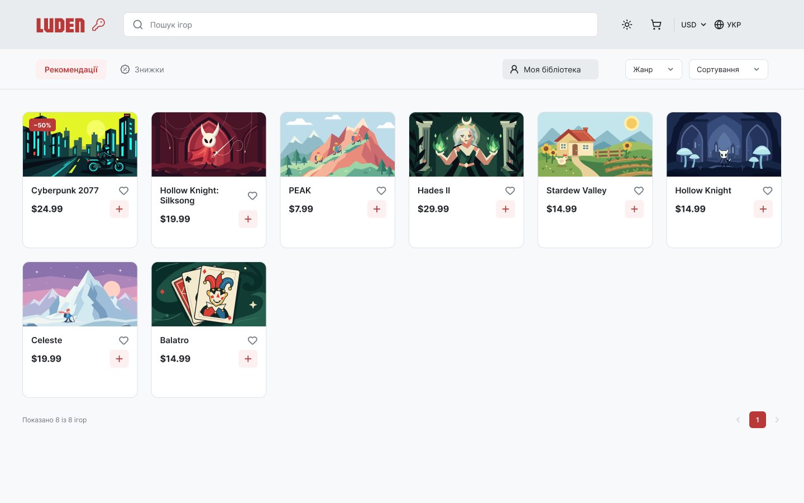

# Luden UX/UI Design Project

Luden — магазин цифрових ігор. Мета першого релізу — дати покупцеві змогу знайти гру, переглянути її деталі, оплатити замовлення й відкрити покупку в бібліотеці. Команда визначає вимоги, проєктує desktop-інтерфейс і перевіряє основний сценарій та його помилкові стани.

Luden у Figma містить 15 desktop-кадрів 1440 × 900, 33 переходи й три стартові потоки. Основний маршрут показує покупку Cyberpunk 2077 і повернення до бібліотеки. Покриття вимог і відкриті питання описано в [Plan Review](03_figma_prep/04_Plan_Review.md) та [QA](05_qa/Test_Cases.md).

## Робочі матеріали

- [Luden у Figma](https://www.figma.com/community/file/1700961790605683605) · [Бриф](03_figma_prep/05_Figma_Brief_v0.1.md) · [Покриття 33 AC](03_figma_prep/04_Plan_Review.md)
- [Кадри та результати візуального огляду](04_design/06_Review_Report.md)
- [Огляд зауважень і рекомендацій](05_qa/Demo_Review_Script.md) · [Журнал рев’ю](05_qa/AI_Interaction_Log.md)
- [Відеозахист Luden на YouTube](https://youtu.be/3DZtVHCVIjE)
- [План відеозахисту](05_qa/Defense_Guide.md)

## Склад команди та розподіл ролей

| Учасник | Роль | Зона відповідальності |
| --- | --- | --- |
| Паламарчук Антон | Frontend | G2–G3 · навігація, каталог і стани інтерфейсу |
| Таісія Сергєєва | UI/UX | G5, F1–F2, P1 · дизайн-бриф, wireframes, переходи та візуальні правки |
| Панковський Тимофій | Frontend/Backend | G4, G6 · рев’ю плану, простежуваність і перевірка наскрізного сценарію |
| Татьков Олександр | Backend | G1, G3 · реєстрація, автентифікація і матриця прав |
| Кисельов Олександр | Backend | G3, QA · замовлення, оплата, бібліотека і перевірка станів |

[Команда та індивідуальні завдання для захисту](TEAM.md)

## Інструкція з перевірки

1. У Figma відкрийте Present і потік «Покупка гри». Натисніть «Увійти», з порожньої бібліотеки перейдіть до магазину.
2. Відкрийте **Cyberpunk 2077 ($24.99)** → «До кошика» → «До оплати» → «Підтвердити». Очікуваний кадр — бібліотека з цією грою; реальний платіж не виконується.
3. Перейдіть до магазину після покупки й відкрийте «Моя бібліотека»: має повертатися S-03-B.
4. У каталозі натисніть на поле пошуку, щоб побачити готовий результат. Натисніть на поле ще раз, щоб відкрити стан без збігів. Для відмови оплати й помилки каталогу виберіть однойменні стартові потоки.
5. Зіставте побачене з [планом F-T01…F-T06](05_qa/Test_Cases.md#перевірки-figma-у-present). Втрата контексту в окремих поверненнях та непідключені контроли зафіксовані в [рев’ю](05_qa/Defect_Change_Log.md#ревю-figma).

## Структура репозиторію

| Розділ | Артефакти |
| --- | --- |
| `01_requirements/` | [Специфікація Release MVP](01_requirements/00_Product_Baseline.md), [Input Pack і Source Check](01_requirements/01_Input_Pack_v0.1.md), [Decision Log](01_requirements/Decision_Log.md) |
| `02_architecture/` | [Screen Map](02_architecture/02_Screen_Map.md), [Screen Contracts, матриці та Traceability](02_architecture/03_Screen_Contracts.md) |
| `03_figma_prep/` | [Plan Review](03_figma_prep/04_Plan_Review.md), [Figma Brief](03_figma_prep/05_Figma_Brief_v0.1.md) |
| `04_design/` | [Review Report і кадри Figma](04_design/06_Review_Report.md) |
| `05_qa/` | [Журнал рев’ю](05_qa/AI_Interaction_Log.md), [Defect & Change Log](05_qa/Defect_Change_Log.md), [Test Cases](05_qa/Test_Cases.md) |
